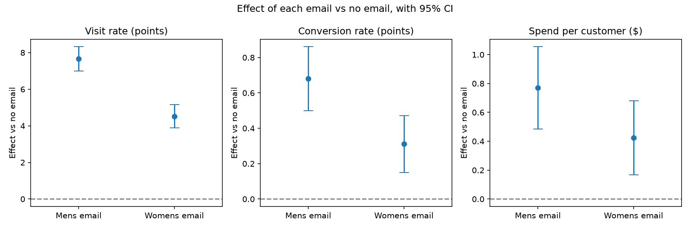

# Does Sending the Right Email Matter? An A/B/C Email Test

I looked at an email test on 64,000 customers. I wanted to answer three things: does sending an email help, does it help more when the email matches what the customer bought before, and which customers we can stop emailing.

## Why I did this

Most A/B test projects I saw only compare two groups with one test and stop there. I wanted to go a bit further:

- There are three groups here, not two, so I had to correct for running more than one test.
- I wrote down my plan and saved it in git before I looked at any results, so I could not pick the tests that looked best later.
- I checked the results in more than one way (regression, shuffling test, bootstrap).
- I ended with a real business question: who should get which email, and is it worth the cost?

## Data

The data is the MineThatData E-Mail Challenge by Kevin Hillstrom (2008). It is a public dataset from a US online retailer. It is not client work.

64,000 past customers were split at random into three equal groups:

- one group got an email about men's products
- one group got an email about women's products
- one group got no email

For the next two weeks the company tracked whether each customer visited the website, bought something, and how much they spent. My notes on the data are in [data_notes.md](data_notes.md).

## What I did

1. **Checked the split was fair** ([notebook 01](01_data_and_checks.ipynb)). The three groups are the same size (p = 0.90), and customers in each group look alike on age of account, past spend, location and so on. I also worked out the smallest effect the test could detect.
2. **Wrote the plan first** ([analysis_plan.md](analysis_plan.md)). I saved it in git before calculating any results. Any change after that is written in [decisions_log.md](decisions_log.md).
3. **Main results** ([notebook 02](02_main_effects.ipynb)). I compared each email group with the no-email group. I used a simple difference in averages, a regression that also uses customer details (Lin method), CUPED, a shuffling (permutation) test, and a bootstrap for spend. I used the Holm correction because there are two main tests.
4. **Does matching the email help?** ([notebook 03](03_personalization_and_heterogeneity.ipynb)). I compared customers who got the email matching their past category with those who got the other one. I also checked whether the email worked differently for new customers and for recent buyers.
5. **Who should get which email?** ([notebook 04](04_targeting_policy.ipynb)). I split the customers in half. On the first half I found the best action (men's email, women's email or no email) for each of 12 customer groups. On the second half I checked how much profit that rule really makes and compared it with simple rules like "email everyone".
6. **Excel profit calculator** ([excel/](excel/), [excel_guide.md](excel_guide.md)). SUMIFS, INDEX/MATCH, a margin × cost sensitivity grid and the held-out results side by side.

## Results

| | No email | Men's email | Women's email | Men's email effect (95% CI) | Women's email effect (95% CI) |
|---|---|---|---|---|---|
| Visited the site | 10.6% | 18.3% | 15.1% | +7.7 points (7.0 to 8.3) | +4.5 points (3.9 to 5.2) |
| Bought something | 0.57% | 1.25% | 0.88% | +0.68 points (0.50 to 0.86) | +0.31 points (0.15 to 0.47) |
| Spend per customer | $0.65 | $1.42 | $1.08 | +$0.77 ($0.49 to $1.04)* | +$0.42 ($0.18 to $0.69)* |

\* bootstrap CI



What I found:

- **Emails work.** Both emails brought more people to the site. The men's email almost doubled visits. Both results hold after the correction for two tests and in the shuffling test.
- **Matching helps, but only one way.** Getting the matching email raised visits by 3.1 points. But this came only from men's buyers, who mostly ignored the women's email. Women's buyers liked both emails about the same. Matching did not clearly raise spend.
- **New vs old customers, recent vs older buyers:** the email worked about the same for all of them.
- **Who to stop emailing:** my rule made $0.341 profit per customer, and "men's email to everyone" made $0.338. So the profit is about the same, but my rule **sends 24.5% fewer emails**. The rule only clearly wins when each email is costly.
- **Using customer details to reduce noise** (Lin and CUPED) barely helped here, only 1.5% and 0.02%. Last year's spend tells us very little about spend in the next two weeks.

A one-page summary is in [memo.md](memo.md).

## What I would do differently

- For CUPED, use the same thing measured before the test (for example spend in the 2 weeks before the email) instead of last year's total spend.
- Some of my 12 customer groups were small (about 150 people per email type), so their numbers were noisy. A model that shares information between groups would probably work better.
- Track unsubscribes and longer-term sales. The main reason to send fewer emails is to avoid annoying customers, and this data does not show that.
- Put the men's vs women's email comparison in the plan too. I only looked at it as an extra.

## How to run

```bash
python3 -m venv ~/.venvs/email-experiment
source ~/.venvs/email-experiment/bin/activate
pip install -r requirements.txt

mkdir -p data
curl -L -o data/hillstrom.csv "http://www.minethatdata.com/Kevin_Hillstrom_MineThatData_E-MailAnalytics_DataMiningChallenge_2008.03.20.csv"

jupyter notebook
```

Run the notebooks in order, 01 to 04 (Restart & Run All). I set the random seed to 2026, so you get the same numbers every time. I did not upload the CSV because I could not find clear terms for sharing it, so the command above downloads it. I keep the virtual environment outside the project folder because Python does not allow one in a folder name with `:` in it.

---

*Gandharv Gedam, M.Sc Economics, IIT Kanpur*
